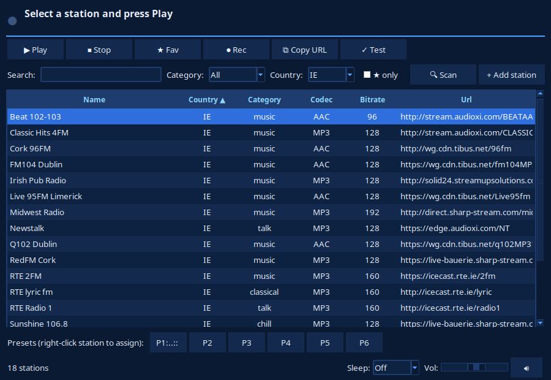

# Mint Radio

Low-memory internet radio player for Linux Mint (Cinnamon). Python + Tkinter + mpv. ~55 MB while playing.



## Download

Grab the latest `.deb` from
[GitHub Releases](https://github.com/djshades2004/mint-radio/releases),
then install it:

```bash
sudo dpkg -i mint-radio_*_all.deb
sudo apt-get install -f   # only if dpkg reports missing dependencies
```

Or find **Mint Radio** in the Mint menu afterwards.

## Install

```bash
chmod +x install.sh
./install.sh
mint-radio
```

Or find **Mint Radio** in the Mint menu. Uninstall: `./uninstall.sh`.

Needs: `mpv`, `python3-tk` (installer adds them via apt).

## .deb package (for sharing / system-wide install)

```bash
./packaging/build-deb.sh          # produces dist/mint-radio_<ver>_all.deb
sudo dpkg -i dist/mint-radio_*_all.deb   # pulls in mpv etc. via apt
```

Installs to `/usr/share/mint-radio` with launcher `/usr/bin/mint-radio`;
remove with `sudo apt remove mint-radio`. Version is read from `main.py`,
so just bump `VERSION` and rebuild.

## Features

- 41 bundled stations — UK, US + Ireland (RTE, Newstalk, Today FM, Cork/ Limerick/ Dublin locals) across music, talk/news, classical, jazz, chill — plus your own custom stations
- Search / filter by name, category, country, ★ favorites only; click any column header to sort (default: country)
- 6 presets (right-click a station to assign, keys `1–6`)
- ★ favorites, persisted + last station & volume restored
- Volume slider + mute (live, no restart), ICY now-playing metadata
- Sleep timer (5/15/30/60/90 min)
- ⏺ Record stream to `~/Music/MintRadio/`
- 🌐 Online search of radio-browser.info (~30k stations), add results locally
- 🔍 Bulk scan: top stations by country + genre (sizes 20–500, or "All genres" fan-out for 1000+ candidates), each stream auto-tested, import the working ones
  - Three directories: radio-browser.info, **Shoutcast** (keyless search endpoint; tune-in links auto-resolved), and **Icecast** via internet-radio.com genre pages (sorted by listeners, paged; `.pls` links auto-resolved). Imports tagged `[Shoutcast]` / `[Icecast]`, country `Web`
- ✓ One-click stream health check, ⧉ copy URL
- Shortcuts: `Space` play/stop, `F` fav, `M` mute, `/` search, `↑↓` navigate
- Minimize-to-tray (Mint native, zero extra deps — toggle in File menu; left-click tray icon for Show/Hide, Play/Stop, Quit). Guaranteed paths: `Ctrl+H` or File → Hide to tray now, optional close-button-hides-to-tray; plain minimize is also intercepted where the window manager reports it

## Files

| File | Purpose |
|---|---|
| `main.py` | The whole app (stdlib only, no pip deps) |
| `stations.json` | Bundled stations |
| `mint-radio.desktop` | Mint menu entry |
| `assets/icon.svg` | App icon |
| `install.sh` / `uninstall.sh` | User-local installer |
| `TECH_SHEET.md` | Design notes |

Config: `~/.config/mint-radio/` (`favorites.json`, `settings.json`, `custom.json`).

## License

GPL-3.0-or-later — see [LICENSE](LICENSE).
